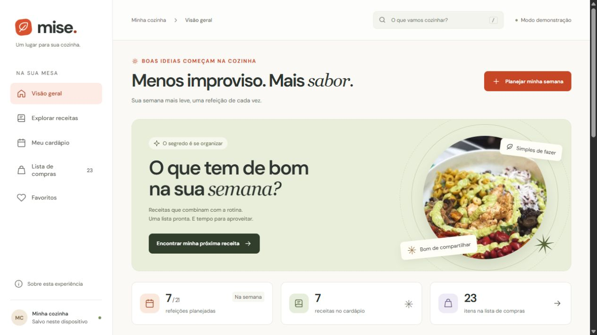

# Mise — sua semana à mesa

Um aplicativo de planejamento de refeições que conecta receitas, cardápio semanal e lista de compras. Uma experiência de front-end com Vue 3, TypeScript e Vite, sem serviços de aplicação.

**[Abrir demonstração gratuita](https://gustapaz.github.io/mise/)**



## Da ideia à sacola

- Visão geral com resumo do planejamento, prévia da semana e sugestões.
- Oito receitas ilustrativas com ingredientes, preparo em passos marcáveis, dicas e ajuste de 1 a 8 porções.
- Busca por nome ou ingrediente, filtros por refeição, tempo e categoria, favoritos e estados vazios.
- Cardápio com três refeições por dia, navegação entre semanas independentes, substituição e remoção de receitas.
- Lista de compras agrupada por setor, com ingredientes compartilhados somados conforme as porções e marcação do que já está separado.
- Downloads de cardápio e lista de compras em texto, gerados no navegador.
- Armazenamento local com validação de dados recuperados e aviso quando indisponível.
- Menu móvel, seleção de dia em telas pequenas, modais nativos, gerenciamento de foco, atalho `/` para busca e movimento reduzido.

## Stack e execução

Vue 3 (Composition API e componentes SFC), TypeScript, Vite, CSS e ícones SVG próprios. Fonte DM Sans servida localmente. Fotos otimizadas para WebP em três tamanhos, sem requisições a provedores de imagens durante o uso.

Requer **Node.js 24** e npm.

```sh
npm ci
npm run dev
npm test
npm run build
npm run preview
```

O aplicativo abre em `/mise/`. `npm run format` formata o código com Prettier. O workflow verifica testes, tipos e build e publica o diretório `dist` no GitHub Pages.

## Organização

```text
src/
  components/   Componentes de imagem, ícones e receitas
  data.ts       Receitas e cardápio de exemplo
  domain.ts     Agregação de ingredientes e validação
  store.ts      Estado reativo, semanas e persistência
  App.vue       Navegação e fluxos da interface
  style.css     Sistema visual e layouts responsivos
tests/          Regras de negócio, recuperação e assets
```

## Mocks e privacidade

Tudo funciona no cliente. Não há backend, banco, API de aplicação, cadastro, conta real, compras ou cobrança. O perfil “Minha cozinha” é demonstrativo. Receitas e fotografias são ilustrativas, sem cálculo nutricional ou prescrição de dieta.

O estado fica na chave `mise-kitchen` do `localStorage`: cardápios, favoritos e itens separados. Não existe sincronização entre dispositivos. Os passos de preparo marcados permanecem apenas enquanto a receita está aberta. Alterações no cardápio desmarcam os itens de compras daquela semana para evitar usar uma conferência antiga com novas quantidades. A água e os temperos a gosto não entram na lista de compras.

Não há analytics, rastreadores ou fontes remotas. A hospedagem pode processar registros técnicos conforme a [política do GitHub](https://docs.github.com/pt/site-policy/privacy-policies/github-general-privacy-statement).

## Navegação, SEO e desempenho

Rotas por hash mantêm recarga e links diretos compatíveis com GitHub Pages, sem servidor de redirecionamento. A aplicação é renderizada no cliente: metadados sociais e canonical descrevem a experiência principal; não há páginas indexáveis individuais por receita. A escolha prioriza uma experiência interativa, diferente de um site editorial estático.

O documento declara idioma, descrição, favicon e metadados sociais. As imagens têm dimensões, `srcset` e carregamento tardio fora da capa. O JavaScript de produção e as fontes são servidos pela própria hospedagem.

## Validação

`npm test` verifica agregação e escala de ingredientes, ausência de itens em semanas vazias, exclusão de água, formatação brasileira, recuperação de estado inválido e presença dos assets de todas as receitas. `npm run build` inclui a checagem de tipos.

A inspeção no navegador cobre busca, filtros, porções, inclusão e remoção no cardápio, semanas independentes, persistência, favoritos, lista, downloads, menu móvel e teclado. Layouts conferidos em desktop, tablet e celular. Ajustes de contraste são verificados em textos da interface, sem declarar certificação ou pontuações Lighthouse.

## Licenças e créditos

Código: [MIT](LICENSE), Gustavo Paz. DM Sans: [SIL Open Font License](docs/FONT-LICENSE.txt). Dependências mantêm suas licenças próprias.

Fotografias sob a [licença Pexels](https://www.pexels.com/license/), excluídas da licença MIT. São referências visuais; apresentação e ingredientes podem diferir das receitas:

| Referência | Origem                                                    |
| ---------- | --------------------------------------------------------- |
| Salada     | [Pexels 6541815](https://www.pexels.com/photo/6541815/)   |
| Massa      | [Pexels 803963](https://www.pexels.com/photo/803963/)     |
| Bowl       | [Pexels 13803824](https://www.pexels.com/photo/13803824/) |
| Sopa       | [Pexels 6978238](https://www.pexels.com/photo/6978238/)   |
| Torrada    | [Pexels 7936662](https://www.pexels.com/photo/7936662/)   |
| Aveia      | [Pexels 4725747](https://www.pexels.com/photo/4725747/)   |

`optimize.mjs` reproduz a otimização local com Sharp para JPGs colocados em `public/images/`.
